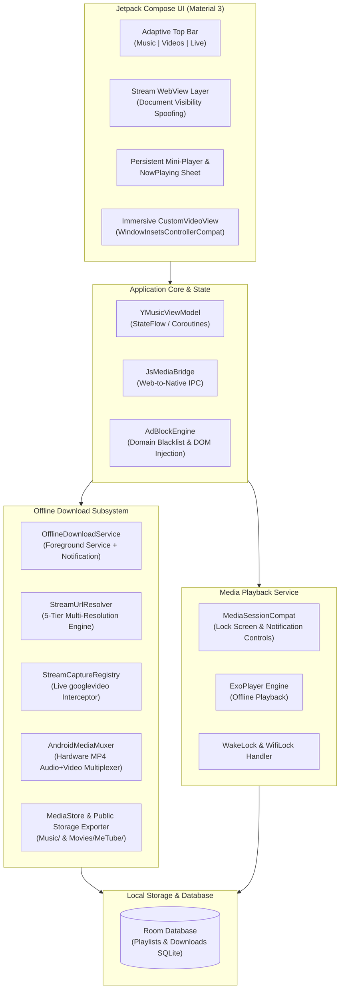

<div align="center">

# 🎬 MeTube

### **The Full YouTube & YouTube Music Experience for Android — Free, Ad-Free, and Without Terms & Conditions**

[-3DDC84?style=for-the-badge&logo=android&logoColor=white)](https://android.com)
[](https://kotlinlang.org)
[](https://developer.android.com/jetpack/compose)
[](#-built-in-ad-shield)
[](LICENSE)

<br/>

<p align="center">
  <b>MeTube</b> gives you all the core features of the official YouTube and YouTube Music mobile apps without subscriptions, without tracking, and <b>without forcing you to agree to any Terms of Service or Privacy Agreements</b>. Just install and start watching or listening immediately.
</p>

[**Download APK**](#-installation) • [**Features**](#-features) • [**Comparison**](#-metube-vs-official-youtube) • [**Architecture**](#-architecture--tech-stack) • [**Build from Source**](#-build-from-source)

</div>

---

## 🌟 Vision & Philosophy

Most video and music platforms restrict essential features like **background playback**, **offline downloading**, and **Picture-in-Picture** behind costly monthly paywalls, while requiring users to accept invasive data tracking policies and user agreements.

**MeTube is built with a simple mission:**
1. **Zero Sign-In Forced**: Never prompts for Google account logins or sign-in walls.
2. **No Mandatory Agreements**: No terms & conditions to accept, no tracking consent popups, and no cookies harvested.
3. **100% Local Privacy**: Your watch history, playlists, favorites, and downloaded media remain entirely on your device.
4. **YouTube Premium Features for Everyone**: Enjoy background audio, PiP, ad-free streaming, and full offline downloads for free.

---

## ✨ Features

### 🛡️ Built-in Ad-Shield
* **Zero Video Ads**: High-performance ad request blocker and instant ad fast-forward engine eliminate pre-roll, mid-roll, and post-roll video advertisements.
* **Clean Interface**: Removes sponsored banners, promotional carousels, upsell modals ("Try YouTube Premium"), and dialog backdrops.
* **Live Counter**: Real-time shield indicator in the top bar displaying the number of blocked trackers and ads.

### 🎧 Background Audio Playback
* **Screen Off Playback**: Turn off your phone screen and keep listening to music, podcasts, or lectures with zero interruptions.
* **App Switching**: Seamlessly switch between apps while audio continues playing in the background.
* **Lock Screen & Notification Controls**: Integrated with Android's `MediaSession` with interactive Play, Pause, Next, and Previous controls.
* **WakeLock Protected**: Uses `PARTIAL_WAKE_LOCK` and Foreground Service guarantees so Android's battery optimizer never cuts off your stream.

### 🖼️ Picture-in-Picture (PiP)
* Multitask effortlessly: watch videos or live streams in a floating, resizable window while chatting, browsing, or using other apps.
* Tap the dedicated PiP button in the top bar or let the player transition automatically.

### 📥 Uninterrupted Background Downloader
* **Background Foreground Service**: Powered by `OfflineDownloadService` with `FOREGROUND_SERVICE_TYPE_DATA_SYNC` and persistent notification progress bars (0–100%). Downloads never terminate when minimizing the app or locking the screen.
* **Multiple Formats per Video**: Download the same song or video in multiple resolutions without overwriting:
  * 🎥 **HD 720p MP4 Video** (Dual-track video + AAC audio muxed with `AndroidMediaMuxer`)
  * 🎬 **360p MP4 Video** (Optimized for quick downloads and low storage)
  * 🎵 **M4A High-Quality Audio** (Crystal-clear 128–160kbps AAC audio)
  * 🎶 **MP3 Audio Format** (Broad compatibility with older car stereos and media players)
* **Automatic Gallery & Music Library Sync**: Completed downloads are automatically exported to public storage (`Music/` and `Movies/MeTube/`) and registered with Android `MediaStore`.
* **Zero-Failure Resolution**: Built-in 5-tier stream resolver (Live Stream Capture Registry $\rightarrow$ InnerTube Android VR $\rightarrow$ Watch Page Session $\rightarrow$ Adaptive Stream Fallback).

### 📺 True Immersive Fullscreen Video
* True edge-to-edge fullscreen video overlay with sticky immersive system bar hiding (`WindowInsetsControllerCompat`).
* Automatically hides app navigation bars and mini-players during fullscreen video.
* System Back gesture exits fullscreen video cleanly and restores orientation.

### 🌐 3-in-1 Adaptive Stream Modes
* **[Music]**: YouTube Music interface with full desktop engine integration and audio controls.
* **[Videos]**: YouTube mobile interface with maximum vertical viewing area for video, description, and comments.
* **[Live]**: Dedicated live stream directory with real-time stream status.
* Equal-weight responsive chips (`weight(1f)`) that dynamically adapt to any screen width and resolution.

### 📂 Local Playlists & Offline Library
* Create, rename, and manage custom playlists stored in a local SQLite database powered by **Room**.
* Reorder tracks, add streams or downloaded files to playlists, and play entire collections without an internet connection.

### ⏱️ Built-in Sleep Timer
* Fall asleep to your favorite music or ambient sounds. Set timers (15m, 30m, 45m, 60m, or custom duration) that smoothly pause playback when time expires.

---

## 📊 MeTube vs Official YouTube

| Feature | Official YouTube App | YouTube Premium | MeTube |
| :--- | :---: | :---: | :---: |
| **Price** | Free with Ads | $13.99 / month | **100% Free Forever** |
| **Terms & Conditions Required** | ⚠️ Mandatory | ⚠️ Mandatory | ❌ **None (Zero Agreements)** |
| **Account / Sign-in Required** | ⚠️ Forced | ⚠️ Forced | ❌ **No Account Needed** |
| **In-Stream Video Ads** | Heavy (Up to 2+ ads) | None | **Completely Blocked** |
| **Banner & Upsell Popups** | Constant | Reduced | **Completely Blocked** |
| **Background Audio Playback** | ❌ Blocked | ✅ Allowed | ✅ **Supported (Screen on/off)** |
| **Picture-in-Picture (PiP)** | ⚠️ Limited / Paid | ✅ Allowed | ✅ **Supported Everywhere** |
| **HD Video Downloads** | ❌ Blocked | ⚠️ In-App Only | ✅ **Direct MP4 / M4A to Storage** |
| **Public MediaStore Export** | ❌ None | ❌ Encrypted Blob | ✅ **Exports to Music / Gallery** |
| **Sleep Timer** | ❌ None | ⚠️ Limited | ✅ **Built-in System** |
| **Data Tracking & Telemetry** | ⚠️ High | ⚠️ High | ❌ **Zero Data Collection** |

---

## 🏗️ Architecture & Tech Stack



### Technology Highlights
* **Jetpack Compose & Material 3**: Modern, declarative UI with smooth animations, animated vector icons, and dynamic theme colors.
* **Foreground Service Architecture**: Continuous background execution with Android 14/15 `FOREGROUND_SERVICE_TYPE_DATA_SYNC` compliance.
* **AndroidMediaMuxer Hardware Multiplexing**: Merges high-definition video streams with synchronized AAC audio tracks natively with zero external dependencies.
* **Chromium Web Engine with Visibility API Spoofing**: Overrides HTML5 Page Visibility API so YouTube web never halts playback when the screen locks or tabs change.
* **Room Persistence Library**: High-performance SQLite ORM managing downloaded items, custom playlists, and playback queues.
* **OkHttp 4**: Resilient network client with automated range requests, chunk sanitization, and redirect handling.

---

## 🚀 Installation

### Option 1: Direct APK Download
1. Download the latest **[MeTube.apk (v1.0.0)](https://github.com/CLPUYIR/metube/releases/download/v1.0.0/MeTube.apk)** directly or check the [**Releases**](https://github.com/CLPUYIR/metube/releases) tab.
2. Open the downloaded file on your Android device (Android 8.0 Oreo or higher).
3. If prompted, enable **"Install from unknown sources"** for your browser or file manager.
4. Tap **Install** and launch MeTube. Enjoy ad-free streaming and background play with zero setup!

---

## 🛠️ Build from Source

### Prerequisites
* **Android Studio** (Ladybug / Iguana or later) or standalone **Android SDK** (API Level 35+)
* **JDK 17** or **JDK 21**
* **Git**

### Step-by-Step Build Instructions

1. **Clone the repository:**
   ```bash
   git clone https://github.com/CLPUYIR/metube.git
   cd metube
   ```

2. **Open in Android Studio** or build directly from terminal:
   ```bash
   # On Windows PowerShell / Command Prompt:
   .\gradlew.bat assembleDebug

   # On Linux / macOS:
   chmod +x gradlew
   ./gradlew assembleDebug
   ```

3. **Locate the generated APK:**
   ```
   app/build/outputs/apk/debug/app-debug.apk
   ```

4. **Install onto a connected Android device or emulator:**
   ```bash
   adb install -r app/build/outputs/apk/debug/app-debug.apk
   ```

---

## 🔒 Permissions & Security

MeTube only requests permissions that are strictly necessary for core functionality:

| Permission | Purpose |
| :--- | :--- |
| `android.permission.INTERNET` | Loading YouTube streams, artwork, and media data |
| `android.permission.ACCESS_NETWORK_STATE` | Monitoring network connectivity for seamless buffering |
| `android.permission.FOREGROUND_SERVICE` | Uninterrupted background audio playback and background file downloads |
| `android.permission.FOREGROUND_SERVICE_DATA_SYNC` | Android 14+ background downloading service compliance |
| `android.permission.WAKE_LOCK` | Keeping the CPU active during screen-off audio playback and active downloads |
| `android.permission.POST_NOTIFICATIONS` | Displaying playback controls and live download progress notifications |

> 🛡️ **Zero Tracking Guarantee**: MeTube contains no analytics SDKs, no ad networks, no Firebase Crashlytics tracking, and no external telemetry beacons.

---

## ❓ Frequently Asked Questions (FAQ)

<details>
<summary><b>Does MeTube require Google Play Services or microG?</b></summary>
<br/>
No. MeTube is completely standalone. It does not require Google Play Services, microG, or any account framework to function.
</details>

<details>
<summary><b>Why does MeTube not require agreeing to Terms and Conditions?</b></summary>
<br/>
MeTube is an independent client interface and media player. We do not maintain user accounts, do not harvest private telemetry, and do not store user data on remote servers. Because there is no contract or data agreement between the user and any third-party server, no user agreement is needed.
</details>

<details>
<summary><b>Where are downloaded files saved?</b></summary>
<br/>
Downloaded music files are saved to your phone's standard <code>Music/</code> directory, and video files are saved to <code>Movies/MeTube/</code>. They are immediately available in your phone's Gallery, VLC, Poweramp, or any other media player.
</details>

<details>
<summary><b>Can I download the same video in multiple formats?</b></summary>
<br/>
Yes! You can download a 720p HD MP4 video for visual viewing, and also download the M4A/MP3 audio track for offline music listening. MeTube tags each format distinctly so they never overwrite one another.
</details>

---

## ⚖️ Disclaimer

* **MeTube** is an open-source project developed for educational, accessibility, and personal media playback purposes.
* "YouTube" and the YouTube logo are registered trademarks of Google LLC. This project is not affiliated with, endorsed by, or in any way associated with Google LLC or YouTube.
* All content streamed or downloaded through MeTube belongs to their respective content creators and copyright owners.

---

<div align="center">
  <b>Crafted with ❤️ for freedom, privacy, and an uncompromised media experience.</b>
</div>
